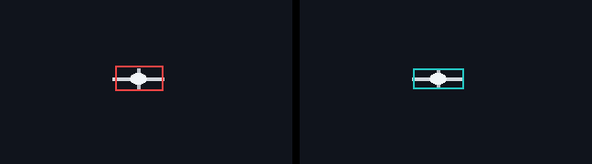

# 视频框区间平滑与 AI 补齐

在 [X-AnyLabeling](https://github.com/CVHub520/X-AnyLabeling)（CVHub，GPL-3.0）里给**水平矩形**视频标注加两件事：

- **区间平滑**：不看像素。用你确认过的首尾和中间关键帧，对已有框做有界去抖或插值。
- **AI 补齐**：可选。用 SAM 2.1 视频传播，从人工关键帧补中间帧。没有权重时整段跳过，平滑不受影响。

纯计算（平滑、插值、框/掩码几何、分块缓存、带备份的原子写入）不依赖界面和 GPU，可以用 pytest 单独测。

本仓库**不**附带上游约 300 KB 的 `label_widget.py`。接入方式是一份针对标签 `v4.0.0-beta.7` 的小补丁，见 `integration/`。

## 区间平滑

选一个连续帧段和一个带组 ID 的矩形。首尾帧锁定。你可以再锁中间帧，或拖一条边作为人工约束。然后：

- `smooth`：在「靠近现有框」和「二阶差分更小」之间求解，每条边的自动移动不超过你设的像素上限（界面默认 1 px，强度默认 4）。
- `interpolate`：在锁定帧之间对四条边做线性插值，同样受这个上限和图像边界约束。

人工拖过的边优先，不受自动上限裁剪，但不能越出图像或让矩形交叉。预览只存在内存里。点应用才写 JSON。

## AI 补齐

人工关键帧是依据。已有的框不会自动变成关键帧。模型没检出时不补框，也不删原来的目标。写回的自动框带 `temporal_ai_generated`，不会把模型结果标成你已经确认过。

可选能力：正负点、在关键帧上涂可见区域、旋翼/浅灰边的局部二次跟踪、分块缓存。这些都在独立进程里跑 SAM 2.1 Small，主进程不导入 torch。

## 安全设计

- 人确认的关键帧坐标原样保留。
- 先预览，再写入。预览期间如果 JSON 或图片被改过，写入会停。
- 写入是：整文件序列化 → 临时文件 → `os.replace`。失败时按已写文件回滚。
- 每次应用在标注目录留下 `.temporal_smoothing_backups` 或 `.temporal_tracking_backups`。撤销比对哈希；应用之后又被改过的文件会让整批撤销停下来，避免盖掉新的人工修改。
- 只改选中的 `label + group_id`。其他目标和其余 JSON 字段保留。
- 跟踪会话、提示点、涂抹图写在 `XAL_TEMPORAL_HOME/runtime/`（默认是当前工作目录），不写进图片目录。

## 安装

需要 Python 3.11+。平滑只需要 numpy 和 Pillow。

```bash
pip install -e .
# 要打开对话框：
pip install -e ".[gui]"
# 开发与测试（含 PyQt6，仍不含 SAM2 权重）：
pip install -e ".[dev]"
```

X-AnyLabeling 请固定在 **v4.0.0-beta.7**。补丁说明在 [`integration/INTEGRATION.md`](integration/INTEGRATION.md)：

```bash
git clone --branch v4.0.0-beta.7 --depth 1 https://github.com/CVHub520/X-AnyLabeling.git
cd X-AnyLabeling
patch -p1 < /path/to/this/repo/integration/x-anylabeling-v4.0.0-beta.7-temporal.patch
```

SAM 2 是可选的。把 `examples/tracking_runtime.example.json` 复制为 `$XAL_TEMPORAL_HOME/runtime/tracking_runtime.json`，自行下载 [SAM 2.1 Hiera Small](https://github.com/facebookresearch/sam2) 权重并填写 `checkpoint` 和 `python`。不要把 `.pt` 提交进 git。未配置时点击「AI 补齐」会提示环境未就绪。

## 用法

1. 打开一个图片帧文件夹。给目标画水平矩形并设置组 ID，保存当前帧。
2. **区间平滑**：至少三帧连续标注，每帧恰好一个同 ID 矩形。生成预览后可拖边，确认再应用。撤销在同一个窗口。
3. **AI 补齐**：输入你确认过的帧号。生成预览，检查「待检查」列表，再应用。

界面依赖完整的 X-AnyLabeling 进程，本仓库的 CI 不启动它。下面是合成序列上平滑前后的裁剪（左红：带抖动的原框，右青：平滑结果）。



同一段的短 GIF：[`docs/figures/synthetic_before_after.gif`](docs/figures/synthetic_before_after.gif)。

重新生成：

```bash
python examples/run_demo.py
```

这次在 60 帧、320×180 的合成机身加十字机臂上测到的非关键帧结果（关键帧为第 0、10、…、50、59 帧的真实框；平滑用强度 4、上限 6 px）：

| 方法 | 平均 IoU | 中心误差 (px) | IoU>0.5 |
| --- | ---: | ---: | ---: |
| 抖动后的标注 | 0.777 | 2.38 | 100% |
| 关键帧线性插值 | 0.824 | 2.02 | 100% |
| 区间平滑（上限 6 px） | 0.906 | 0.89 | 100% |
| 库内插值，缺帧用上一关键帧填充 | 0.755 | 3.19 | 98.1% |

非关键帧 53 帧。AI 补齐因未安装 SAM2 而跳过。这些数字来自本次 `examples/run_demo.py`，不是外推。

## 公开数据评测

脚本：`python scripts/download_public_demo.py`

数据下载到 `data/davis2017/`（已 gitignore），**不会**提交图片或标注。CI 不跑这个脚本；`tests/test_sam2_optional.py` 里对应测试直接 skip。

选用 **DAVIS 2017 TrainVal 480p**，不用 VisDrone、UAV123、Anti-UAV、LaSOT、GOT-10k：

- VisDrone 常见再分发条款是 CC BY-NC-SA，非商业。
- Anti-UAV 2025 材料为 CC BY-NC。
- LaSOT、GOT-10k 面向研究评测，没有可随 GPL 演示随意再分发的许可。
- UAV123 页面没有明确的开放许可，且混有第三方视频。
- SeaDronesSee 本体是 CC0、也来自无人机，但官方图像是一个约 30 GB 的 zip，且当前服务器不接受 HTTP Range。不适合作为默认的小演示。

DAVIS 组织者以 BSD 发布数据和代码；2017 challenge 页面同时把新增标注写成 CC BY 4.0。两者都允许本脚本下载后本地评测。引用：

- F. Perazzi, J. Pont-Tuset, B. McWilliams, L. Van Gool, M. Gross, A. Sorkine-Hornung. A Benchmark Dataset and Evaluation Methodology for Video Object Segmentation. CVPR 2016.
- J. Pont-Tuset, F. Perazzi, S. Caelles, P. Arbeláez, A. Sorkine-Hornung, L. Van Gool. The 2017 DAVIS Challenge on Video Object Segmentation. arXiv:1704.00675, 2017.

框不是数据集自带的矩形，而是调色板掩码的轴对齐外接框：`(xmin, ymin, xmax+1, ymax+1)`。每个序列只取一个对象 id（出现帧数最多，并列时取总面积更大者）。

序列都在 2017 **val**：`car-shadow`（40 帧，对象 id 1）、`motocross-jump`（40 帧，对象 id 2，主体是车手与车，不是背景碎片）。没有使用名为 `drone` 的训练片段：那是多目标展会镜头，最大掩码是人，不是无人机。

协议：每 10 帧加最后一帧为关键帧，坐标等于真值。下表只统计**非关键帧**（各 35 帧）。`library_*` 调用的是 `xal_temporal.smoothing.refine_boxes`。hold-last 实验把缺失帧初始化成上一关键帧，上限设成图像长边（854 px），这大于对话框里 50 px 的滑块上限，所以它是库调用，不是界面默认值。去抖实验给非关键帧加 `N(0, 3px)` 噪声，再以强度 4、上限 8 px 平滑。

SAM2：**未运行**。环境里没有 `torch` / `sam2`，脚本不下载权重。

| 序列 | 方法 | 平均 IoU | 中心误差 (px) | IoU>0.5 |
| --- | --- | ---: | ---: | ---: |
| car-shadow | 四边线性插值 | 0.9701 | 2.94 | 100% |
| car-shadow | 库插值 + hold-last | 0.9701 | 2.94 | 100% |
| car-shadow | 库平滑 + hold-last | 0.8242 | 16.22 | 100% |
| car-shadow | 仅 3 px 抖动 | 0.9455 | 2.73 | 100% |
| car-shadow | 抖动后平滑（上限 8 px） | 0.9796 | 1.10 | 100% |
| motocross-jump | 四边线性插值 | 0.7717 | 28.81 | 100% |
| motocross-jump | 库插值 + hold-last | 0.7732 | 28.76 | 100% |
| motocross-jump | 库平滑 + hold-last | 0.4810 | 61.71 | 40.0% |
| motocross-jump | 仅 3 px 抖动 | 0.9695 | 2.18 | 100% |
| motocross-jump | 抖动后平滑（上限 8 px） | 0.9539 | 4.70 | 100% |

读法：目标真的在移动时，平滑不是跟踪器。hold-last 再做平滑会把框留在上一关键帧附近，IoU 低于线性插值（motocross 上 IoU>0.5 只有 40%）。对话框默认上限是 1 px，本来就是用来修已有框的抖动。car-shadow 运动慢，3 px 噪声再用上限 8 px 的平滑能靠近真值（0.946 → 0.980）。motocross 上同样的 3 px 噪声相对大框很小，平滑的曲率项把框拉离观测，IoU 从 0.969 降到 0.954。库插值在 car-shadow 上与独立线性插值一致；在 motocross 上略高 0.0015，来自边界裁剪，不是另一套模型。

## 限制

- 只处理一个文件夹、一个 `label + group_id`、水平矩形。旋转框、同一帧多个同 ID 框、帧号不连续、全景接缝跳变会拒绝。
- 平滑不看图像，不知道真实边界，也不会自动缩框。更平滑不等于更准。
- 细结构（桨、腿、机臂）在全图跟踪里容易被吃掉。旋翼模式用局部第二次传播和人工框宽高比做弱约束，误检的大块背景有反例，仍要人看。
- 暗场景、浅色地面、与杆状物交叠时，点提示和涂抹也只是辅助，不是准确率证明。
- 待检查规则（尺寸突变、双向分歧、贴边）会漏，也不表示置信度。
- AI 路径默认 SAM 2.1 Small。权重、显卡和驱动都不在本仓库里。CPU 能跑，只是慢。

## 测试

```bash
pip install -e ".[dev]"
QT_QPA_PLATFORM=offscreen pytest
```

GitHub Actions（`.github/workflows/tests.yml`）在 Python 3.11 和 3.12 上跑同一命令，不下载 DAVIS，也不装 SAM2。当前环境：55 passed，2 skipped（SAM2 导入、公开数据脚本）。

## 许可与致谢

- 本仓库 GPL-3.0。它从 X-AnyLabeling 的 GPL 代码延伸而来，请保留 `LICENSE`。
- X-AnyLabeling：Wei Wang / CVHub，<https://github.com/CVHub520/X-AnyLabeling>，GPL-3.0。
- SAM 2：Meta，Apache-2.0，<https://github.com/facebookresearch/sam2>。本仓库不包含其代码和权重。
- 评测序列来自 DAVIS 2017，见上文引用与 BSD / CC BY 4.0 说明。

## English

Interval smoothing and optional SAM 2.1 gap filling for horizontal video boxes in X-AnyLabeling 4.0.0-beta.7. Smoothing never looks at pixels: confirmed keyframes stay fixed, other edges move only inside a pixel limit, and nothing is written until preview. Apply is an atomic replace with a hashed backup and undo. AI fill is a separate process. It does not run without a local SAM 2.1 Small checkpoint, and it does not mark predictions as human keyframes.

Install with `pip install -e .` (add `[gui]` or `[dev]` for PyQt6). Apply `integration/x-anylabeling-v4.0.0-beta.7-temporal.patch` to a checkout of tag `v4.0.0-beta.7`. Do not commit weights.

`python examples/run_demo.py` builds a 60-frame synthetic drone-like clip. On the 53 non-keyframes, smoothing at a 6 px limit raised mean IoU from 0.777 (jittered boxes) to 0.906 against the rendered box. Linear interpolation of the keyframes scored 0.824.

`python scripts/download_public_demo.py` fetches two DAVIS 2017 val clips (`car-shadow`, `motocross-jump`) by HTTP range, converts the largest consistent mask id to boxes, and scores non-keyframes. The dataset is not committed. CI skips it. SAM 2 was not run here (no torch, no weights). Holding the previous keyframe and then smoothing is worse than linear interpolation when the object moves (motocross-jump mean IoU 0.481 vs 0.772, and only 40% of frames with IoU>0.5). Smoothing helps when the boxes already exist and are slightly noisy and the motion is slow (`car-shadow`: 0.946 → 0.980). Full table and license notes are in the Chinese section above. Numbers are from one local run of that script, not a leaderboard claim.

Popular UAV benchmarks were not used because their licenses are non-commercial or unspecified. DAVIS is BSD, with the 2017 annotations also described as CC BY 4.0 by the challenge page.
